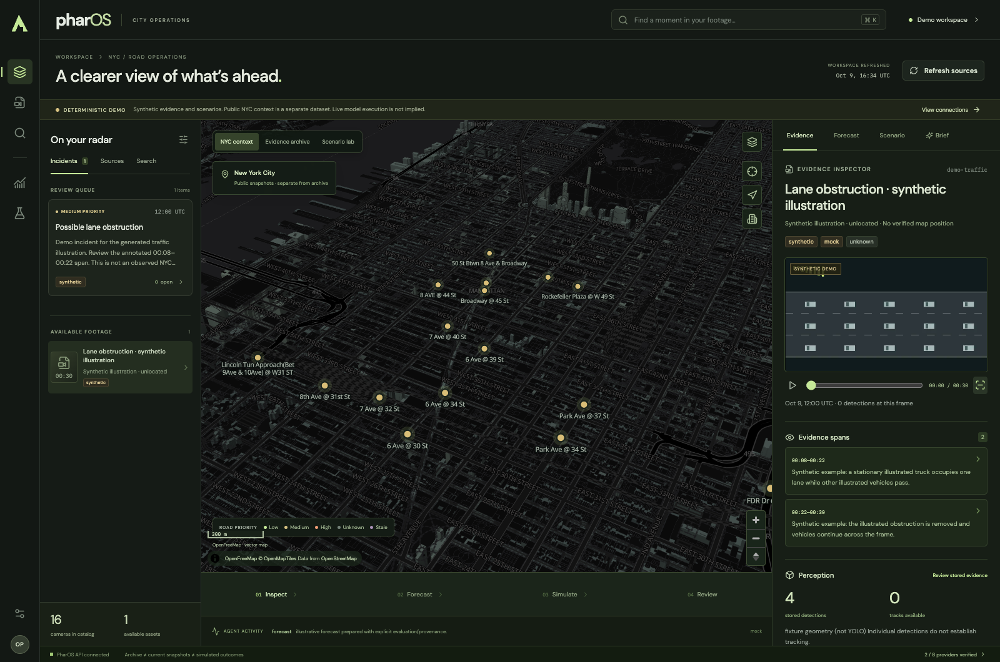

# PharOS

A road-operations intelligence console for reviewing footage, searching evidence, exploring traffic forecasts, and comparing obstruction-clearance scenarios. Built for the VAST Builders Challenge, with an NYC context map and an explicitly separate licensed archive.



The local demo is working; Team 8's actual archive and W&B adapters passed verification. Watch the [39-second demo](docs/demo/pharos-local-demo.webm) or see the [verification report](docs/VERIFICATION.md) for measured results and the remaining fresh-pipeline/deployment requirements.

## Run locally

Python 3.12+, Node 22+, and a WebGL2-capable browser are required. No service credentials are needed for the labeled demonstration.

```bash
python3 -m venv .venv
.venv/bin/python -m pip install -r requirements-dev.txt -r requirements-simulation.txt
cd frontend
npm ci
npm run build
cd ..
bash scripts/start.sh
```

Open [PharOS](http://127.0.0.1:8765). `PORT` changes the local port. `.env.example` documents server-side configuration; copy it to `.env` only for local configuration. On the workshop VM, preserve its existing environment instead of overwriting it with example values. `requirements.lock` records the tested complete Python environment, including simulation and development tools; `frontend/package-lock.json` locks browser dependencies.

`scripts/start.sh` builds a missing frontend but does not silently install Python dependencies. The app starts with cached, verified camera locations, a generated 30-second traffic illustration, and a genuine OSM network. The map loads vector tiles from OpenFreeMap and needs Internet access. All fixtures are labeled synthetic; missing upstream services are explicit.

## Walk through the demo

1. Inspect the NYC camera map. Camera coordinates come from the public catalog; current snapshot access is separately gated by the DOT developer agreement.
2. Select **Possible lane obstruction** or the synthetic illustration. Seek to **00:08** and inspect the annotation. Demo boxes are fixture geometry, not YOLO output.
3. Search **lane obstruction**. Demo uses labeled keyword matching. A connected workshop uses VSS hybrid retrieval with Cosmos Embed1 and VastDB.
4. Open **Forecast**, select a road, and run the illustrative forecast. Review per-horizon baseline errors, uncertainty coverage and synthetic provenance.
5. Open **Scenario**, run the comparison, and inspect baseline, early and late clearance under equal demand and seeds. Replay the actual SUMO outputs on the map.
6. Generate an operator brief. Demo uses a deterministic cited template; connected mode calls W&B and validates returned evidence IDs.

The demo illustration is unlocated. The simulation uses a First Avenue OSM corridor with **synthetic demand and assumed signals**, independent of archive footage and current NYC conditions. Unobserved roads remain unknown. Risk/priority scores are not accident probabilities. See [the walkthrough](docs/DEMO_WALKTHROUGH.md).

## What is implemented

- React/TypeScript console with MapLibre 3D buildings, camera filters, camera/road selection, evidence spans, timestamped detection overlays, search, provider diagnostics, forecast controls and synchronized SUMO replay.
- FastAPI service, canonical evidence/provenance schemas, SQLite state, idempotent jobs, cooperative cancellation, bounded work and SSE events.
- Auditable Playwright source discovery and cached NYC catalog/context adapters. Source failures and stale data remain visible. Sensor samples are retained locally for the configured history window.
- Server-side VSS login/session refresh, inventory, metadata schema discovery, hybrid search, stored Cosmos reasoning, YOLO sidecars, parent/segment identity, and HTTP Range media proxying. JWTs stay off browser URLs.
- Conservative image-space tracking only when sidecars contain supported temporal detections. No camera calibration, world trajectories or physical speeds are fabricated.
- W&B operational inference with structured evidence IDs, model/latency recording, and optional locally installed Weave tracing.
- One-chunk re-ingestion preview with exact prompt and preserved metadata. Shared archive writes default off; new-media uploads are disabled.
- Persistence and historical time-of-week baselines, chronological evaluation, and uncertainty coverage. Live sensor forecasts require recent, associated, unit-confirmed measurements. The inspected DOT speed feed does not currently meet those conditions.
- Actual SUMO/TraCI runs over a versioned, connected OSM corridor. Metrics account for completed, unfinished and pending-insertion vehicles; immutable input files and replay are persisted locally.
- Team 8 `/app` deployment packaging using public runtime images, small ConfigMap source payload, mounted runtime/build volumes, server-side Secrets and operator authentication.

## Workshop connection

Read [verified interfaces](docs/INTEGRATIONS.md), [live verification](docs/WORKSHOP_VERIFICATION.md), and [deployment instructions](deploy/README.md). The assigned environment is **Team 8**. VSS and the NVIDIA pipeline are supplied by the organizers; this repository does not deploy duplicate GPUs, models, vector databases or DataEngine functions.

Normal access uses `USERNAME`, `PASSWORD`, and `INGRESS_URL`. W&B additionally uses `WANDB_API_KEY`, `WANDB_TEAM`, `WANDB_PROJECT`, and a provider-listed `WANDB_MODEL`. Direct model diagnostics preserve the actual team endpoint/auth configuration. Credentials alone never produce a healthy provider badge.

The native Browser Use controller failed at startup with a sandbox `TIOCSTI` error during this build. The local Playwright fallback successfully inspected public sources and controlled the assigned existing workshop desktop. No extra VM was launched. API verification and any remaining blockers are recorded separately from the local prototype.

## Tests

```bash
.venv/bin/python -m pytest -q
cd frontend && npm test && npm run build
cd ..
.venv/bin/python scripts/browser_smoke.py
```

The simulation suite executes the native SUMO engine, opens a local TraCI socket, and requires process/network permission in restricted environments. Browser verification uses installed Chrome by default; use `--chrome /path/to/chromium` or install Playwright Chromium. It saves screenshots and a result JSON under ignored `artifacts/`. A focused responsive browser check also lives in `frontend/tests/browser_smoke.py`.

Tests cover upstream protocols, 401 refresh, token concealment, Range playback, missing sidecars, grounded citations, source caching/freshness, risk deduplication, chronological forecasting, deterministic simulation, complete demand accounting, cancellation, persistence, request validation, operator access and deployment packaging. See [verification notes](docs/VERIFICATION.md).

## Project structure

| Path | Responsibility |
| --- | --- |
| `backend/app.py`, `models.py`, `jobs.py`, `store.py` | API, shared contracts, orchestration and persistence |
| `backend/data_adapters`, `backend/ingestion` | Public context, archive discovery and guarded re-ingestion |
| `backend/retrieval`, `backend/inference`, `services/tracking` | VSS evidence/search, W&B synthesis and temporal sidecar support |
| `backend/forecasting`, `backend/risk` | Numerical baselines and explainable priority |
| `backend/simulation`, `simulation` | TraCI worker, OSM network, assumptions and reference metrics |
| `frontend` | Map-centered operator console |
| `scripts`, `deploy` | Reproducible local checks and workshop packaging |

## Scope and attribution

The app prepares evidence and recommendations for a person; it does not dispatch responders or control infrastructure. Public NYC snapshots are separate from permission to ingest media into the challenge. The NYC DOT developer-feed agreement is handled by the user with DOT; PharOS sends no external messages. No hackathon submission or public deployment is implied by this repository.

Third-party sources and licenses are documented in [THIRD_PARTY.md](docs/THIRD_PARTY.md). OlympusOS was inspected as an MIT-licensed architectural reference; PharOS's implementation is independently written. Map and network data carry OpenStreetMap attribution. Source URLs, timestamps, hashes and simulation assumptions are retained in the repository.
