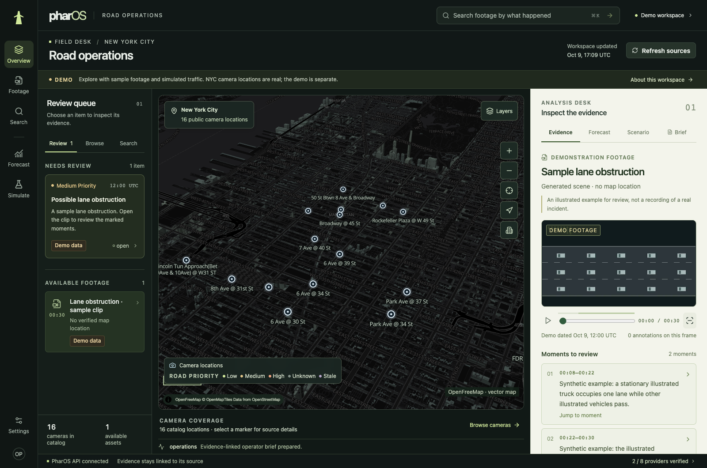
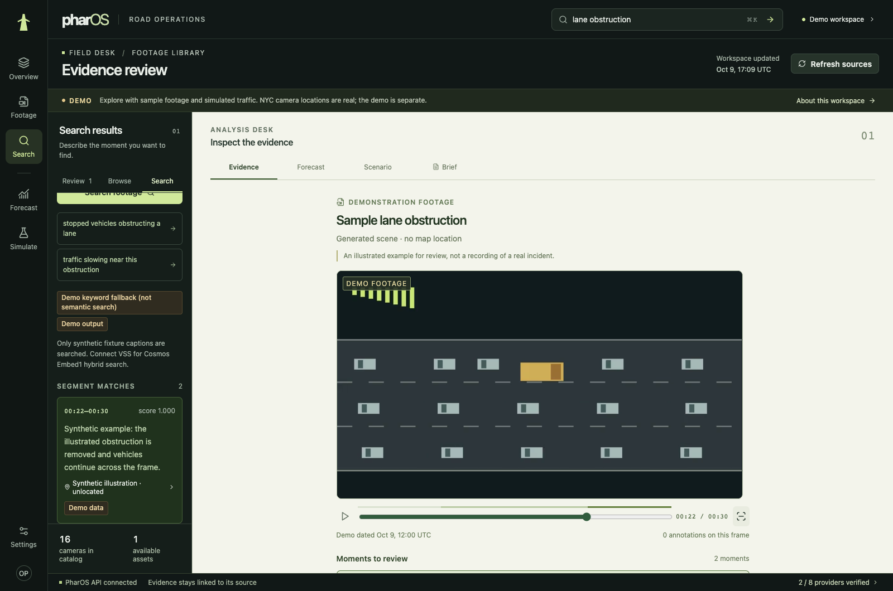

# PharOS design refinement

The interface now reads as a road-operations desk: a dark geographic workspace,
an explicit review queue, and a contrasting paper-colored evidence report. Lime
marks actions and selection; pale blue camera markers no longer resemble priority
scores. System typography removes a third-party font request and raises normal
body copy to 14px and metadata to 12px, with rem-based sizing.

| Before | After | Why |
| --- | --- | --- |
| Generic headline and repeated navigation | Specific workspace title, labeled rail and one analysis sequence | Clearer location and next action |
| Small green text on green surfaces | Ivory report, dark ink, larger text and restrained accent colors | Evidence is easier to read |
| Unlocated clip beside an empty map | Wide evidence report on desktop; explicit location state on mobile | Space goes to the available information |
| Raw `mock` badges and prominent model metadata | Plain source labels and expandable technical details | Explains provenance without leading with implementation |
| Undifferentiated evidence spans | Numbered moments, selected state and scrubber coverage | Makes time navigation understandable |
| Scenario inputs start with seed/name; results list every metric | Clearance times first, advanced settings collapsed, three signed outcomes | Centers the operator's decision while retaining full metrics |
| Tiny mobile rail and repeated headings | Full-width Browse / Map / Analysis views and compact chrome | Gives the active task room |
| Uniform map motion and incomplete popover focus handling | Immediate keyboard/reduced-motion actions, short pointer transitions, Escape/outside dismissal | Keeps interaction predictable and controllable |

No new animation library, decorative looping motion, generated hero imagery or
random metrics were added. Demo, historical footage, unavailable coordinates,
uncertainty and unfinished simulated trips remain explicit. The provider APIs and
backend behavior are unchanged.

The design work used the user-invoked **design-engineering** and **apple-design**
skills: clear wayfinding, immediate press feedback, progressive disclosure,
purposeful motion, system typography and accessibility preferences.

## Verification

- Frontend typecheck and production build pass; **12 unit tests pass**, including
  signed comparison wording, missing-versus-zero values and vehicle-time units.
- The full browser workflow passes: 3D map, evidence playback and boxes, search,
  forecast, actual SUMO comparison/replay, cited brief, dialog and mobile layout.
  See [the recorded result](verification/design-browser.json).
- Seven focused accessibility checks pass at 1600px desktop, 768px tablet and
  390px mobile, including all analysis panels with 200% text, popover dismissal
  and focus return, panel scroll reset, and actual keyboard/reduced-motion map
  behavior. See [results](verification/design-accessibility.json). These are
  focused checks, not a claim of a complete accessibility certification.
- The [54-second demo](demo/pharos-design-demo.webm) records the real redesigned
  workflow; full VP8 decode passes and the browser reports zero page errors.
- Deployment packaging tests pass (**5 tests**); the source bundle remains below
  the ConfigMap guard. No workshop deployment was performed.

Reproduce browser checks with `scripts/browser_smoke.py` and the focused
`frontend/tests/design_review.py`. Browser checks use Chrome with actual local API
responses; simulated traffic is produced by SUMO.

